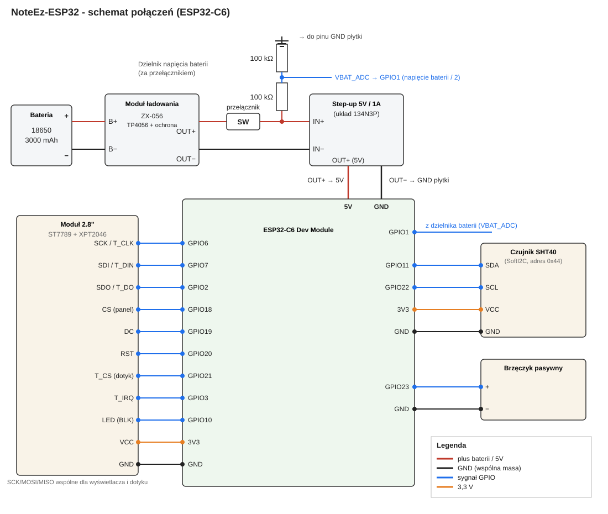

# NoteEz-ESP32 - schemat połączeń (ESP32-C6)

Stan zweryfikowany z kodem ([Config.h](../NoteEz-ESP32/Config.h), [Display.h](../NoteEz-ESP32/src/display/Display.h)) i fizycznym urządzeniem (2026-11-08).

Źródło SVG: [esp32-wiring.svg](esp32-wiring.svg).

## Zasilanie

Komponenty: ogniwo 18650 (3000 mAh), moduł ładowania ZX-056 (TP4056 z ochroną DW01), zwykły przełącznik, step-up 1-5V → 5V/1A (układ 134N3P).

| Od | Do |
|---|---|
| 18650 + | B+ modułu ładowania |
| 18650 − | B− modułu ładowania |
| OUT+ modułu | przełącznik (wejście) |
| przełącznik (wyjście) | IN+ step-upa |
| przełącznik (wyjście) | górny rezystor 100 kΩ dzielnika |
| OUT− modułu | IN− step-upa |
| OUT+ step-upa (5V) | pin 5V płytki |
| OUT− step-upa | dowolny pin GND płytki |
| dolny rezystor dzielnika | dowolny pin GND płytki |

Pomiar baterii: wyjście przełącznika → 100 kΩ → **GPIO1** → 100 kΩ → GND płytki (dzielenie przez 2, `BATTERY_DIVIDER_RATIO = 2.0`).

Zasady użytkowania:
- Przełącznik wyłączony na czas ładowania (TP4056 nie ma load sharing).
- Przełącznik wyłączony przy podłączaniu USB z komputera (brak diody na pinie 5V - ryzyko back-feed).
- Przed pierwszym uruchomieniem sprawdzić ciągłość IN−/OUT− step-upa (powinny być zwarte).

## Wyświetlacz ST7789 + dotyk XPT2046

| Pin modułu | GPIO |
|---|---|
| SCK / T_CLK | 6 |
| SDI / T_DIN (MOSI) | 7 |
| SDO / T_DO (MISO) | 2 |
| CS (panel) | 18 |
| DC | 19 |
| RST | 20 |
| T_CS (dotyk) | 21 |
| T_IRQ | 3 |
| LED (BLK) | 10 |
| VCC | 3V3 |
| GND | GND |

SCK/MOSI/MISO są wspólne dla wyświetlacza i dotyku (jedna magistrala SPI2).

## Czujnik SHT40 (SoftI2C, adres 0x44)

| Pin | GPIO |
|---|---|
| SDA | 11 |
| SCL | 22 |
| VCC | 3V3 |
| GND | GND |

## Brzęczyk pasywny

| Pin | GPIO |
|---|---|
| + | 23 |
| − | GND |

## Zbiorczo (GPIO)

| GPIO | Funkcja |
|---|---|
| 1 | Bateria - środek dzielnika |
| 2 | MISO (wyświetlacz + dotyk) |
| 3 | T_IRQ |
| 6 | SCLK |
| 7 | MOSI |
| 10 | BLK |
| 11 | SHT40 SDA |
| 18 | CS wyświetlacza |
| 19 | DC |
| 20 | RST |
| 21 | CS dotyku |
| 22 | SHT40 SCL |
| 23 | Brzęczyk |

Piny celowo omijane: GPIO0 (psuje dotyk przez SPI2), 4/5/8/9/15 (strapping), 12/13 (USB), 16/17 (flash). Wolnych pinów nie ma.
